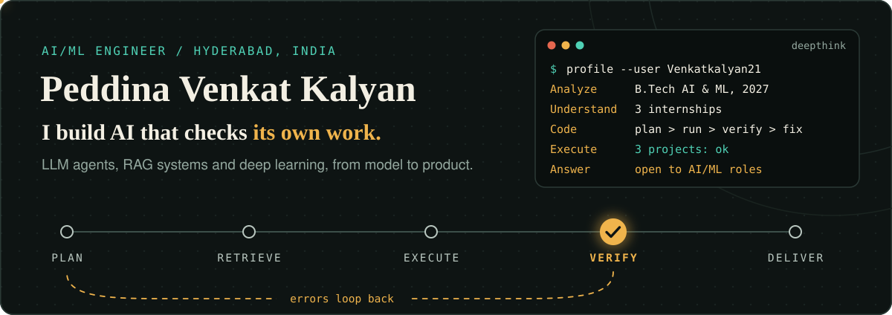
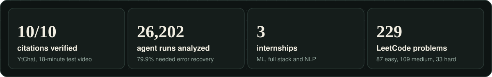
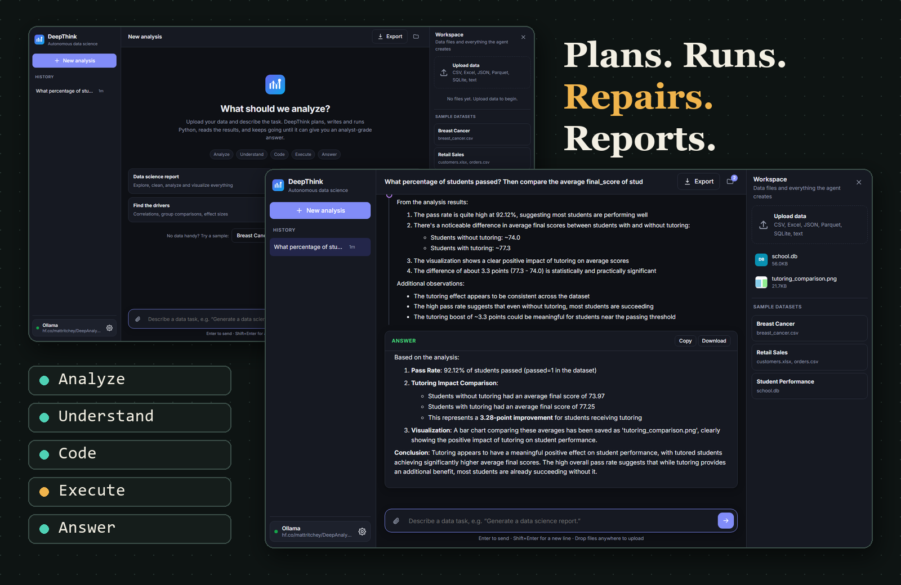
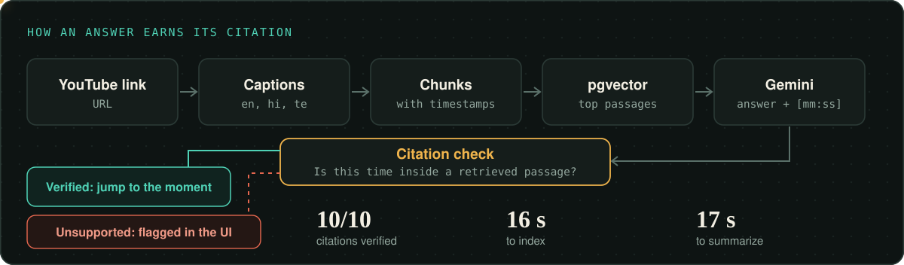
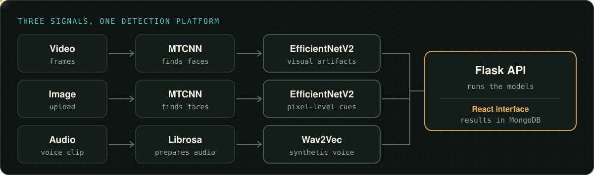
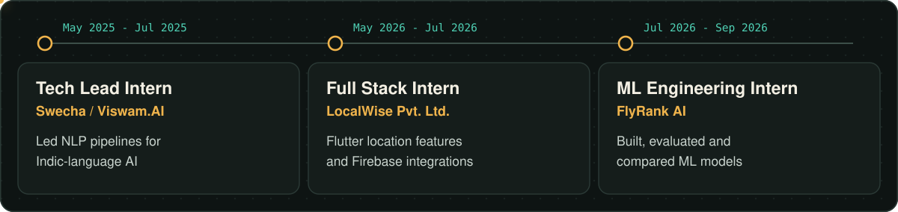
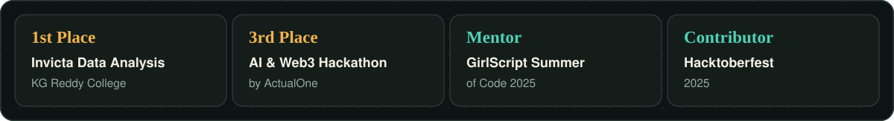

  
    
  
  
  

 

Most AI demos stop at the first answer. I care about what happens next: **checking it, catching the mistake and trying again.** That idea runs through my agents, RAG systems and machine learning work.

## Featured projects

### DeepThink: an AI data scientist

Give it data files and a question. DeepThink plans the analysis, writes Python, runs it, reads the result, repairs its own mistakes and returns a report with charts.

- **Real execution:** a persistent Python session for each analysis, with timeouts and automatic chart capture.
- **Bring any data:** CSV, Excel, JSON, Parquet, SQLite and text files.
- **Bring any model:** Ollama, OpenAI-compatible APIs or Claude. Modeled on the DeepAnalyze research protocol.
- **Research behind it:** I analyzed 26,202 agent runs and found that 79.9% needed error recovery, so recovery sits at the center of the design.

`Python` `FastAPI` `pandas` `scikit-learn` `Docker`

### YtChat: chat with any YouTube video

Paste a link, get a timestamped summary, then ask questions. Every answer points to the moment it came from, and a citation only counts if it falls inside a passage the model actually received. *Built by a team of three.*

`LangGraph` `Gemini` `FastAPI` `PostgreSQL` `pgvector` `Docker` &nbsp; **[View code](https://github.com/Venkatkalyan21/YT-Chat)**

### DeepShield: multi-modal deepfake detection

A team project that looks for manipulated media through facial inconsistencies, pixel-level artifacts and synthetic voice patterns.

`PyTorch` `EfficientNetV2` `MTCNN` `Wav2Vec` `Flask` `React` `MongoDB` &nbsp; **[View code](https://github.com/Venkatkalyan21/Deepfake-detection)**

## Experience

## Toolbox

  

<b>Also:</b> LangChain, LangGraph, RAG, Transformers, pgvector, pandas, NumPy, Power BI, Tableau

## Recognition

<i>Working on agents, RAG or evaluation? I would like to hear about it.</i>

