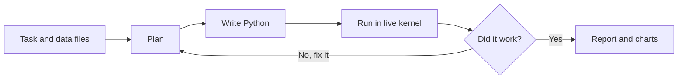

<div align="center">

# Peddina Venkat Kalyan

### I build AI systems that check their own work.

LLM agents · RAG · Deep learning · Full-stack AI

[](https://www.linkedin.com/in/venkat-kalyan-peddina-8381a1287)
[](https://leetcode.com/u/_venkat_kalyan/)


</div>

```text
$ deepthink run "Who is this engineer?" --data github.com/Venkatkalyan21

<Analyze>     Final-year B.Tech student in AI & ML, graduating May 2027. CGPA 8.39/10.
<Understand>  Three internships across ML engineering, full-stack development and NLP.
<Code>        plan() -> run_tools() -> verify() -> fix_errors() -> deliver()
<Execute>     DeepThink: ok | YtChat: ok | DeepShield: ok
<Answer>      Models are easy to demo. I care about whether you can trust the output.
```

## Proof, not adjectives

| Result | What it means |
|:--|:--|
| **10 / 10 citations verified** | YtChat test on one 18-minute video, with every cited timestamp checked against the retrieved passages |
| **16 s to index, 17 s to summarize** | The same YtChat video: 286 caption segments turned into 29 searchable chunks |
| **26,202 agent runs analyzed** | My study for DeepThink found that 79.9% of agentic data science runs needed error recovery, which is why recovery sits at the center of its design |
| **229 LeetCode problems** | 87 Easy, 109 Medium and 33 Hard |

## Featured work

### DeepThink: an AI data scientist

Give it data files and a question. It plans the analysis, writes Python, runs it, reads the result, repairs its own mistakes and hands back a report with charts.



- **Agent loop:** streaming action-tag parser and a persistent Python session for each analysis, with timeouts and automatic chart capture.
- **Works with your data:** CSV, Excel, JSON, Parquet, SQLite and text files.
- **Works with your model:** Ollama, OpenAI-compatible APIs and Claude. Modeled on the DeepAnalyze research protocol.
- **Four ways to use it:** web UI, CLI, Python API and an OpenAI-compatible REST API.

`Python` `FastAPI` `pandas` `scikit-learn` `Docker`

### [YtChat](https://github.com/Venkatkalyan21/YT-Chat): chat with any YouTube video

Paste a link, get a timestamped summary, then ask questions. Every answer points to the exact moment it came from. *Team of three.*

- **Citations are verified, not trusted:** a timestamp only counts if it falls inside a passage the model actually received. Unsupported ones are flagged in the UI.
- **Follow-ups just work:** LangGraph rewrites questions like "and the second one?" into standalone searches.
- **Built to be measured:** retrieved passages, citations, latency and token usage are stored for every message.

`LangGraph` `Gemini` `FastAPI` `PostgreSQL` `pgvector` `Docker`

### [DeepShield](https://github.com/Venkatkalyan21/Deepfake-detection): multi-modal deepfake detection

A team project that looks for manipulated video, images and audio through facial inconsistencies, pixel-level artifacts and synthetic voice patterns.

`PyTorch` `EfficientNetV2` `MTCNN` `Wav2Vec` `Flask` `React` `MongoDB`

## Experience

| When | Role | What I did |
|:--|:--|:--|
| Jul 2026 – Sep 2026 | **Machine Learning Engineering Intern**, FlyRank AI | Built and evaluated ML models, and compared model variants through experiments |
| May 2026 – Jul 2026 | **Full Stack Intern**, LocalWise Pvt. Ltd. | Worked on Flutter location and discovery features, plus Firebase messaging, crash reporting and remote config |
| May 2025 – Jul 2025 | **Tech Lead Intern**, Swecha / Viswam.AI | Led NLP pipeline work for Indic-language AI, selected as Tech Lead through AI Hack Day |

## Toolbox

| Area | Tools |
|:--|:--|
| **AI and ML** | PyTorch, TensorFlow, scikit-learn, Transformers, LangChain, LangGraph, RAG |
| **Backend and apps** | Python, FastAPI, Flask, React.js, Flutter, Firebase, REST APIs |
| **Data** | SQL, PostgreSQL, pgvector, MongoDB, pandas, NumPy, Power BI, Tableau |
| **Shipping** | Git, Docker, Linux |

## Recognition

- **1st Place**, Invicta Data Analysis, Data Science Club, KG Reddy College
- **3rd Place**, AI & Web3 Hackathon, organized by ActualOne
- **Mentor and Contributor**, GirlScript Summer of Code 2025
- **Contributor**, Hacktoberfest 2025

<div align="center">

*Working on agents, RAG or evaluation? I would like to hear about it.*

</div>
